# EventSphere — Backend Architecture & Engineering Specification

> **Instructions for Claude:**
> You are an expert Principal Backend Architect specializing in high-throughput enterprise systems with **Spring Boot 3 (Java 21)** and **MySQL 8**. 
> Review this comprehensive specification for **EventSphere** (an on-site digital engagement PWA for professional conferences). Provide a production-grade, highly scalable backend architecture, directory structure, JPA entity design with MySQL indexing, REST/WebSocket API contracts, and concurrency mechanisms designed to easily handle **2,000+ active attendees per event**.

---

## 1. Executive Summary & Context

**EventSphere** is the modern on-site digital experience and networking layer placed on top of existing event registration systems. Attendees are already registered in an external ticketing/registration portal. EventSphere powers the live, on-site engagement during the summit.

- **Current Reference Event:** India Tech Summit 2026 (`ITS26`), Bengaluru International Centre.
- **Frontend State:** Fully built and polished using **Next.js 14 (App Router)**, **React 18**, and **Tailwind CSS**. 
- **Current Data Layer:** The frontend currently relies on a centralized, reactive mock store in `src/lib/store.tsx` that simulates all actions with `localStorage`.
- **Target Backend Stack:** **Java 21**, **Spring Boot 3.x**, **MySQL 8**, **Spring Security + JWT**, **Spring Data JPA / Hibernate 6**, **Spring AI (with Groq API for matchmaking)**, and **WebSocket (STOMP)**.
- **Concurrency & Scale Goal:** Easily handle **2,000+ concurrent attendees** per event, with bursty traffic during keynotes (rapid poll voting, live Q&A upvoting, badge QR scans, lead capture).

---

## 2. The 3 Core Roles & Detailed User Journeys

The application supports three distinct user roles synchronized across the platform:

### A. Delegate (Attendee Role)
1. **Access Flow:**
   - Instead of standard username/password, attendees access the PWA via an event ticket verification screen: `Event ID` (`ITS26`) + `Registered Mobile` (`+91 9876543210` or Registration ID).
   - The backend verifies registration against the database, issues a signed JWT token, and loads the attendee's profile.
2. **Profile & Privacy Consent Engine:**
   - Delegates configure granular privacy presets: `Open`, `Connections Only`, or `Private`.
   - Toggle specific field sharing: `shareEmail`, `sharePhone`, `shareLinkedIn`.
   - Contact fields are masked when viewed by attendees who are not confirmed connections.
3. **Mutual Networking & Connections:**
   - Attendee directory: Recommended, All, Connected, Pending.
   - Send, accept, or ignore connection requests.
   - Status transitions: `pending` ➔ `connected`.
4. **QR Badge Scanning & "My QR":**
   - Delegates scan physical/digital badge QR codes with their camera.
   - "My QR" generates a cryptographically signed payload referencing their registration token to prevent spoofing.
   - Scanning a badge establishes a mutual connection request instantly.
5. **Interactive Schedule & Sessions:**
   - Multi-day agenda (Days 1–3), track filtering, and session bookmarking.
   - **Session-Scoped Q&A:** Submit questions (with an optional Anonymous toggle), real-time upvoting (each attendee can upvote a question once).
   - **Live Session Polls:** Single-choice polls launched by speakers/organizers. **Strict constraint:** Exactly 1 vote per attendee per poll.
6. **AI Matchmaking / Recommendations:**
   - Recommends top matching attendees (e.g. 94% relevance) and relevant sessions based on attendee interests, skills, company, and role.
   - Uses **Groq API** (Llama 3.1 8B) via **Spring AI** to generate smart personalized 1-sentence match rationales, backed by a persistent MySQL cache.

### B. Exhibitor (Booth Staff Role — e.g., Microsoft Booth B-14)
1. **Home Metrics:**
   - Rapid counter overview: Booth Visits, Captured Leads, Product Enquiries, Team Connections.
2. **Rapid Badge Lead Scanner:**
   - High-speed camera scan of delegate badge QR codes.
   - Instant lead qualification tagging: `New`, `Interested`, `Qualified`, `Contacted`, `Follow-up`.
   - Capture custom conversation notes, product interest tags, and sync status (`synced` / `pending`).
3. **Product Showcase & Lead Capture:**
   - Exhibitor product catalog (e.g., Azure AI, Microsoft Fabric).
   - Tracks brochure downloads, website visits, and direct enquiries.
   - "Interested Visitors" drawer: Lists all attendees who viewed or enquired about specific booth products.
4. **Lead Management & Export:**
   - Search, filter by status, and export booth leads directly to CSV.

### C. Organizer (Admin / Stage Console)
1. **Event Overview Dashboard:**
   - Real-time event telemetry: Total Registered (2,438), Checked In (1,120), Exhibitors (86), Speakers (42), Total Scans, Total Connections.
   - Live Exhibitor Lead leaderboard.
2. **Attendee Management:**
   - Attendee roster with 1-click on-site check-in toggle and check-in timestamp.
   - Walk-in attendee registration modal.
   - CSV roster import with column mapping.
3. **Stage Sessions & Moderation Console:**
   - Live Q&A moderation queue: `Submitted` ➔ `Selected for Stage` ➔ `Mark Answered` ➔ `Archived`.
   - Poll lifecycle manager: Open / Close live voting.
4. **Analytics & Reports:**
   - Hourly scan volume, check-in conversion funnel, session room utilization.
   - One-page client-ready executive summary report with export support.

---

## 3. Existing TypeScript Domain Types (Frontend Contract)

The Spring Boot backend entities and DTOs must align with the frontend types defined in `src/types/index.ts`:

```typescript
export type RoleType = 'delegate' | 'speaker' | 'vip' | 'guest' | 'exhibitor_staff' | 'organizer_staff';
export type DemoRole = 'delegate' | 'exhibitor' | 'organizer';

export interface EventMetadata {
  id: string; // 'ITS26'
  name: string; // 'India Tech Summit 2026'
  dates: string; // '12–14 Feb 2026'
  city: string; // 'Bengaluru'
  venue: string; // 'Bengaluru International Centre'
  status: 'LIVE' | 'UPCOMING' | 'COMPLETED';
  totalRegistered: number;
  totalCheckedIn: number;
  totalExhibitors: number;
  totalSpeakers: number;
  totalScans: number;
  totalConnections: number;
}

export interface PrivacyConsent {
  shareEmail: boolean;
  sharePhone: boolean;
  shareLinkedIn: boolean;
  shareTwitter?: boolean;
  preset: 'Open' | 'Connections Only' | 'Private';
}

export interface Person {
  id: string;
  name: string;
  avatar?: string;
  designation: string;
  company: string;
  role: RoleType;
  bio: string;
  interests: string[];
  skills: string[];
  email: string;
  mobile: string;
  linkedin?: string;
  twitter?: string;
  relevanceScore?: number;
  boothNumber?: string;
  privacy: PrivacyConsent;
  checkedIn: boolean;
  checkInTime?: string;
  registrationId: string;
  ticketType: string;
}

export interface Connection {
  id: string;
  personId: string;
  personName: string;
  designation: string;
  company: string;
  avatar?: string;
  status: 'pending' | 'connected';
  type: 'sent' | 'received';
  source: 'direct' | 'qr_scan' | 'recommended';
  connectedAt: string;
}

export type LeadStatus = 'New' | 'Interested' | 'Qualified' | 'Contacted' | 'Follow-up';

export interface Lead {
  id: string;
  personId: string;
  name: string;
  avatar?: string;
  company: string;
  designation: string;
  email: string;
  mobile: string;
  linkedin: string;
  source: string;
  status: LeadStatus;
  interests: string[];
  notes: string;
  capturedAt: string;
  boothId: string;
  productsViewed: string[];
  syncStatus?: 'synced' | 'pending';
}

export interface Product {
  id: string;
  name: string;
  tagline: string;
  company: string;
  category: string;
  booth: string;
  image: string;
  views: number;
  enquiries: number;
  interestedVisitorsCount: number;
  overview: string;
  features: string[];
  benefits: string[];
  useCases: string[];
  resources: {
    brochureUrl?: string;
    videoUrl?: string;
    websiteUrl?: string;
  };
  isSaved?: boolean;
}

export type QuestionStatus = 'Submitted' | 'Selected' | 'Answered' | 'Archived';

export interface Question {
  id: string;
  sessionId: string;
  text: string;
  authorName: string;
  authorId: string;
  isAnonymous: boolean;
  status: QuestionStatus;
  upvotes: number;
  upvotedBy: string[];
  createdAt: string;
}

export interface PollOption {
  id: string;
  text: string;
  votes: number;
}

export interface Poll {
  id: string;
  sessionId: string;
  question: string;
  options: PollOption[];
  status: 'open' | 'closed';
  totalVotes: number;
  voterIds: string[];
}

export interface Session {
  id: string;
  title: string;
  track: string;
  day: number;
  timeRange: string;
  room: string;
  speakerName: string;
  speakerDesignation: string;
  speakerCompany: string;
  speakerId: string;
  description: string;
  takeaways: string[];
  status: 'live' | 'upcoming' | 'completed';
  attendanceCount: number;
  isBookmarked?: boolean;
  questionsCount: number;
}
```

---

## 4. Entity-Relationship (ER) Model

```mermaid
erDiagram
    EVENTS ||--o{ ATTENDEES : "registers"
    EVENTS ||--o{ EXHIBITORS : "hosts"
    EVENTS ||--o{ SESSIONS : "schedules"
    EVENTS ||--o{ CONNECTIONS : "scopes"

    ATTENDEES ||--|| PRIVACY_CONSENTS : "defines"
    ATTENDEES ||--o{ ATTENDEE_INTERESTS : "has"
    ATTENDEES ||--o{ CONNECTIONS : "initiates_or_receives"
    ATTENDEES ||--o{ LEADS : "captured_as"
    ATTENDEES ||--o{ SESSION_BOOKMARKS : "bookmarks"
    ATTENDEES ||--o{ SESSION_QUESTIONS : "submits"
    ATTENDEES ||--o{ QUESTION_UPVOTES : "casts_upvote"
    ATTENDEES ||--o{ POLL_VOTES : "casts_vote"
    ATTENDEES ||--o{ PRODUCT_ENQUIRIES : "initiates"
    ATTENDEES ||--o{ ATTENDEE_RECOMMENDATIONS : "receives_matches"

    EXHIBITORS ||--o{ LEADS : "captures"
    EXHIBITORS ||--o{ PRODUCTS : "showcases"

    PRODUCTS ||--o{ PRODUCT_ENQUIRIES : "receives"

    SESSIONS ||--o{ SESSION_BOOKMARKS : "saved_in"
    SESSIONS ||--o{ SESSION_QUESTIONS : "moderates"
    SESSIONS ||--o{ POLLS : "conducts"

    SESSION_QUESTIONS ||--o{ QUESTION_UPVOTES : "receives"

    POLLS ||--|{ POLL_OPTIONS : "contains"
    POLLS ||--o{ POLL_VOTES : "tallies"
    POLL_OPTIONS ||--o{ POLL_VOTES : "selected_in"

    EVENTS {
        string id PK "e.g. ITS26"
        string name
        date start_date
        date end_date
        string venue
        string status "UPCOMING|LIVE|COMPLETED"
        datetime created_at
    }

    ATTENDEES {
        string id PK
        string event_id FK
        string registration_id UK "e.g. #0523"
        string name
        string email
        string mobile
        string designation
        string company
        string role "delegate|speaker|vip|guest|exhibitor_staff|organizer_staff"
        string ticket_type
        boolean checked_in
        datetime checked_in_at
        text bio
        datetime created_at
    }

    PRIVACY_CONSENTS {
        string attendee_id PK,FK
        string preset "Open|Connections Only|Private"
        boolean share_email
        boolean share_phone
        boolean share_linkedin
    }

    ATTENDEE_INTERESTS {
        bigint id PK
        string attendee_id FK
        string interest
    }

    CONNECTIONS {
        string id PK
        string event_id FK
        string sender_id FK
        string receiver_id FK
        string status "pending|connected|ignored"
        string source "direct|qr_scan|recommended"
        datetime created_at
    }

    EXHIBITORS {
        string id PK
        string event_id FK
        string company_name
        string booth_number "e.g. B-14"
        string category
    }

    LEADS {
        string id PK
        string exhibitor_id FK
        string attendee_id FK
        string status "New|Interested|Qualified|Contacted|Follow-up"
        text notes
        string sync_status "synced|pending"
        datetime captured_at
    }

    PRODUCTS {
        string id PK
        string exhibitor_id FK
        string name
        string tagline
        string category
        int views_count
        int enquiries_count
        text overview
    }

    PRODUCT_ENQUIRIES {
        string id PK
        string product_id FK
        string attendee_id FK
        string interaction_type "view|save|enquiry"
        datetime created_at
    }

    SESSIONS {
        string id PK
        string event_id FK
        string title
        int day_number "1|2|3"
        string time_range "e.g. 9:30-10:30"
        string room
        string speaker_id FK
        string status "upcoming|live|completed"
    }

    SESSION_BOOKMARKS {
        string session_id PK,FK
        string attendee_id PK,FK
        datetime created_at
    }

    SESSION_QUESTIONS {
        string id PK
        string session_id FK
        string author_id FK
        text question_text
        boolean is_anonymous
        string status "Submitted|Selected|Answered|Archived"
        int upvotes_count
        datetime created_at
    }

    QUESTION_UPVOTES {
        string question_id PK,FK
        string attendee_id PK,FK
        datetime created_at
    }

    POLLS {
        string id PK
        string session_id FK
        string question
        string status "open|closed"
        int total_votes
    }

    POLL_OPTIONS {
        string id PK
        string poll_id FK
        string text
        int votes
    }

    POLL_VOTES {
        string poll_id PK,FK
        string attendee_id PK,FK
        string option_id FK
        datetime voted_at
    }

    ATTENDEE_RECOMMENDATIONS {
        bigint id PK
        string attendee_id FK
        string recommended_id FK
        int relevance_score
        string match_reason
        datetime created_at
    }
```



---

## 5. Concurrency & Performance Requirements (2,000 Users)

The system must handle sharp spikes during event schedule transitions:
1. **Virtual Threads (Project Loom):** Must use Java 21 with `spring.threads.virtual.enabled=true` so thread pooling is not a bottleneck during high I/O spikes.
2. **Hotspot Atomic Updates (Polls & Upvotes):**
   - 500+ attendees may vote in a 30-second keynote window. Voting must enforce single-vote integrity using a composite primary key `(poll_id, attendee_id)` at the database level and atomic counter increments (`UPDATE poll_options SET votes = votes + 1 WHERE id = ...`).
   - Question upvoting must use atomic toggle queries and composite unique constraints `(question_id, attendee_id)` to prevent race conditions and duplicate upvotes.
3. **Database Indexing:**
   - Fast lookup on `(event_id, mobile)` and `(event_id, registration_id)` for sub-millisecond access verification.
   - Composite indexes on `(session_id, status)` for Q&A questions, `(exhibitor_id, status)` for leads, and `(receiver_id, status)` for connection requests.
4. **HikariCP Pool Configuration:**
   - Pool size: 25–35 connections, 20s connection timeout, 5min idle timeout.
5. **AI Recommendation Strategy (Groq + Spring AI):**
   - Groq free tier has strict rate limits (~30 RPM). Real-time LLM calls on every attendee page load will fail.
   - Architecture must use a **precomputed / cached approach**: Fast interest-tag overlap in Java calculates the numeric relevance score (`relevanceScore`), and Groq LLM is called asynchronously or in batches to generate the 1-sentence match explanation, cached in a dedicated `attendee_recommendations` table.

---

## 5. Frontend Integration Architecture

The Next.js frontend has a centralized `useStore()` hook (`src/lib/store.tsx`). 
- **The frontend will not undergo a UI rewrite.**
- Instead, `store.tsx` acts as a facade:
  1. On mount / access confirmation, `useEffect` calls `GET /api/v1/events/ITS26/bundle` to populate state.
  2. Mutators (`connectWith`, `saveLead`, `submitQuestion`, `upvoteQuestion`, `votePoll`, `toggleCheckIn`) will make async REST calls with `Authorization: Bearer <JWT>` and optimistically update React state.
  3. Live Q&A and Polls can subscribe to STOMP WebSocket topics (`/topic/sessions/{sessionId}/qa` and `/topic/sessions/{sessionId}/polls`).

---

## 6. What Claude Should Provide in Response

Please provide:
1. **Full Spring Boot Project Directory & Package Structure** (standard enterprise layered layout).
2. **Complete `pom.xml` Dependencies** (Spring Boot 3.3+, Spring Data JPA, MySQL Connector, Spring Security, JWT, Spring AI OpenAI Starter for Groq, WebSocket, Lombok).
3. **Complete MySQL 8 DDL Schema** with tables, foreign keys, constraints, and performance indexes.
4. **JPA Entity Classes** with proper mappings, cascade settings, and composite keys.
5. **REST API Endpoint Specifications** (Path, HTTP Verb, Request/Response DTOs).
6. **Spring Security & JWT Authentication Architecture** for the phone/event access verification flow.
7. **Groq + Spring AI Recommendation Service** with rate-limit protection, structured JSON output, and caching.
8. **WebSocket / STOMP Configuration** for live session Q&A upvotes and polls.
